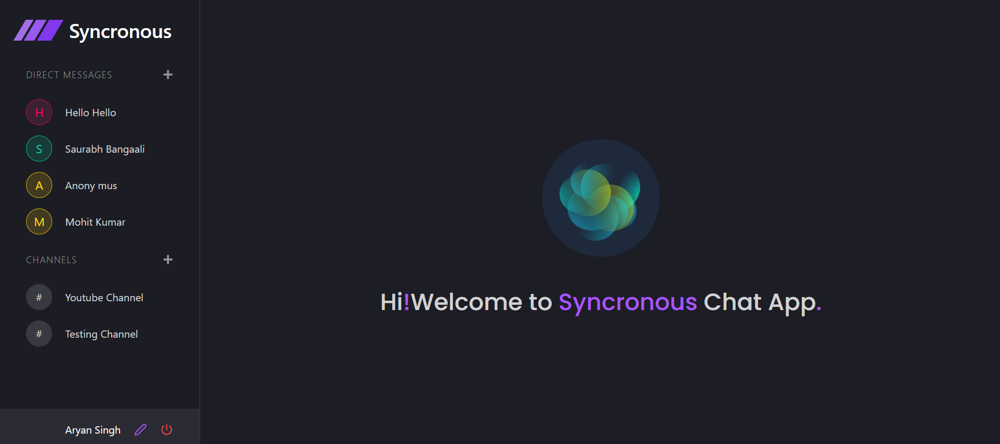
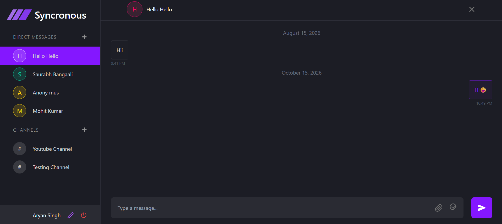
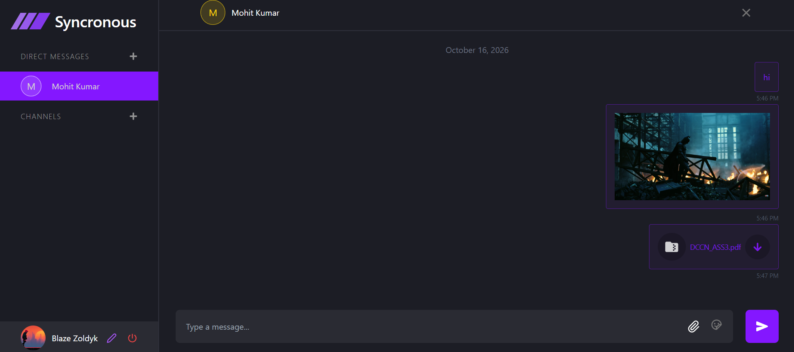
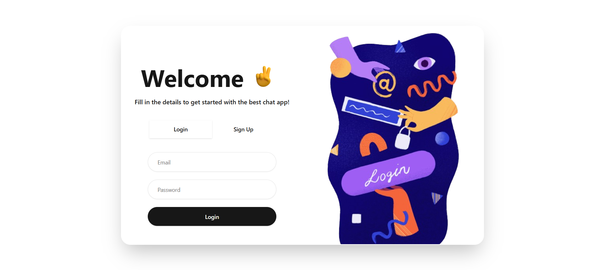
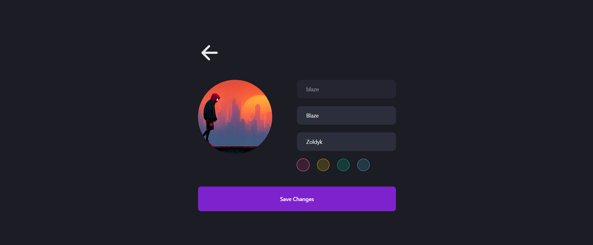

# Real-Time Chat Application

A full-stack real-time chat application built using the MERN stack with WebSocket-based communication powered by Socket.IO. The application supports instant messaging, channel-based conversations, file sharing, authentication, and live user interaction in a responsive and scalable environment.

## Live Demo

[View Project](https://syncat.netlify.app)

## Screenshots

### 1. Dashboard

Displays the application dashboard with direct messages, channels, and user profile options.



### 2. Real-Time Chat

One-to-one messaging interface with timestamps, message history, and a message composer.



### 3. File Sharing

Share images and documents directly within conversations.



### 4. Authentication

Login interface for accessing the application.



### 5. Profile Customization

Customize profile details, avatar, and appearance settings.



## Features

- Real-time one-to-one and channel messaging
- WebSocket communication using Socket.IO
- User authentication and authorization
- File and media sharing support
- Online/offline user status updates
- Persistent chat history storage
- Responsive UI for desktop and mobile devices
- RESTful API integration
- Scalable backend architecture

## Tech Stack

### Frontend
- React.js
- CSS / Tailwind CSS
- Axios

### Backend
- Node.js
- Express.js
- Socket.IO

### Database
- MongoDB
- Mongoose

### Authentication
- JWT Authentication
- bcrypt.js

## Architecture Overview

```text
Client (React.js)
        |
REST APIs + WebSockets
        |
Server (Node.js + Express.js)
        |
Socket.IO Real-Time Engine
        |
MongoDB Database
